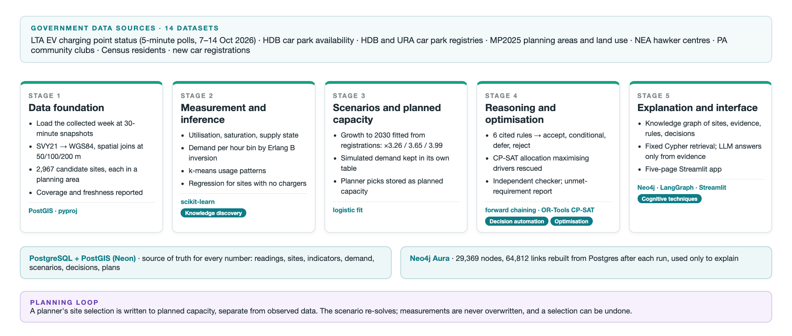
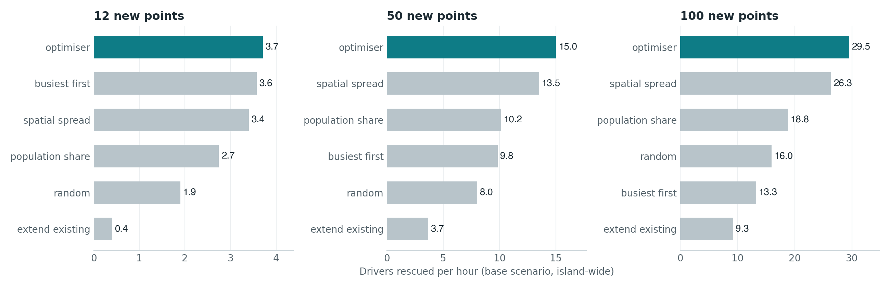

<p align="center">
  <picture>
    <source media="(prefers-color-scheme: dark)" srcset="SystemCode/optev/app/logo-dark.svg">
    
  </picture>
</p>

<h3 align="center">Where should Singapore's next public EV chargers go, how many at each site, and why?</h3>

<p align="center">
  OptEV+ turns live government data into a ranked, budget-checked charging plan,<br>
  and keeps the evidence behind every site it accepts, rejects or defers.
</p>

<p align="center">
  <a href="https://optevplus.streamlit.app"></a>
</p>

<p align="center">
  
  
  
  
  
</p>

<p align="center">
  <a href="#quickstart">Quickstart</a> ·
  <a href="#deploy-on-streamlit-community-cloud">Deploy on Streamlit</a> ·
  <a href="#how-it-works">How it works</a> ·
  <a href="#section-3--credits--project-contribution">Team</a> ·
  <a href="#section-5--user-guide">User guide</a>
</p>

---

## SECTION 1 : PROJECT TITLE

**OptEV+ | Intelligent EV Charging Infrastructure Planner**

NUS-ISS Intelligent Reasoning Systems · Practice Module · Group 25

---

## SECTION 2 : EXECUTIVE SUMMARY / PAPER ABSTRACT

Singapore aims to deploy 60,000 EV charging points by 2030. With more than half already in
place and most HDB car parks served, the planning question has shifted: not *which car park
lacks a charger*, but **which sites get the next tranche, how many points each, and on what
evidence**.

OptEV+ collects live government feeds, infers charging demand from observed occupancy while
reporting how reliable each estimate is, applies cited eligibility rules, allocates charging
points under budget and capacity limits, and keeps the evidence behind every decision, so a
planner can ask *why* and get an answer that cites its sources.

### The problem

- **Pressure is observable but not assembled.** Charger and car park feeds are live, but
  nothing joins them by location or turns them into a measure of how stretched each area is.
- **Selection is heuristic.** Ranking by today's utilisation over-invests in saturated sites
  and misses high-demand places with no chargers yet.
- **Reasons are not retained.** Why a site was left out lives in a spreadsheet, so the
  decision can't be reconstructed later.

### What you get

| Page | What it answers |
|---|---|
| **Overview** | The system at a glance: sites screened, eligible sites, charging points tracked, and the three steps to a plan |
| **Site Map** | Every candidate site on the map, coloured by its rules outcome and sized by the points it gets, over demand hexagons |
| **Eligibility** | Which sites qualify, and the cited rule behind every accept, conditional, defer or reject |
| **Allocation** | How many points go where, the estimated cost, and an independent check of every limit |
| **Demand** | Observed use, inferred demand per hour of the week, and usage patterns |
| **Ask Why** | Plain-language questions, answered only from the evidence in the knowledge graph, or refused |

A planner's own pick is stored as **planned** capacity, separate from what was **observed**,
so every selection can be undone without touching the measurements.

### By the numbers (real data, collected 7–14 Oct 2026)

| | |
|---|---|
| **2,967** candidate sites, every one placed in a planning area | **3.83 M** charger readings and 662,310 car park readings, 330 of 330 half-hour slots |
| **1,574** accept · **288** conditional · **786** defer · **319** reject | **0** constraint violations in any plan |
| **1.12×** the drivers rescued per hour of the best of five baselines, at 100 points | **95%** answer accuracy, **100%** citations, **0** unsupported claims on 20 questions |

### How it works

Five stages, each feeding the next. Every stage reads only what the earlier ones wrote, and
the whole pipeline runs on the real data in about two minutes.

<p align="center">
  
</p>

| Stage | Technique | Built with |
|---|---|---|
| 1 · Data foundation | 14 government datasets and one collected week joined into one candidate-site table | PostGIS spatial joins |
| 2 · Measurement & inference | Demand from occupancy with a reliability bound; usage patterns; demand where no charger exists | Erlang B inversion, k-means, regression |
| 3 · Scenarios | Demand projected to 2030 under declared growth, kept apart from observed data | Logistic growth fit |
| 4 · Reasoning & optimisation | Six cited rules with four outcomes; a constrained allocation; an independent checker | Forward chaining, OR-Tools CP-SAT |
| 5 · Explanation & interface | A knowledge graph of sites, evidence, rules and decisions; grounded answers; the app | Neo4j, LangGraph, Streamlit |

<p align="center">
  
</p>

### Tech stack

**Python 3.12** with **uv** · **PostgreSQL + PostGIS** on Neon (source of truth for every
number) · **Neo4j** Aura (evidence and reasoning links) · **OR-Tools CP-SAT** (allocation) ·
**scikit-learn** (patterns, regression) · **LangGraph** + any OpenAI-compatible model
(grounded answers) · **Streamlit + pydeck + H3** (the app) · **pyproj** (SVY21 ↔ WGS84).

---

## SECTION 3 : CREDITS / PROJECT CONTRIBUTION

| Official Full Name | Student ID | Work Items (Who Did What) | Email |
| :--- | :---: | :--- | :--- |
| Ghanashyam Ramia Kasthurirangan Pandurengan | A0357701E | Team lead. Knowledge graph and explanation layer (cognitive techniques); coverage and freshness reporting; evidence view; installation guide | ghanashyam@u.nus.edu |
| Gurneet Kaur Bhuller | A0354164E | EV charging point collector and data conforming; rules engine and eligibility screening (decision automation); app shell and planned capacity | gurneetbhuller@u.nus.edu |
| Shrey Yadav | A0354457W | Car park collector, spatial joins and planning areas; cost model, allocator and feasibility checker (resource optimisation); deployment | shrey.yadav@u.nus.edu |
| Sushant Maramkulam Shiji | A0354938M | Source checks, database and data access; indicators, demand inference and pattern discovery (knowledge discovery); scenario generation | sushantms@u.nus.edu |

Shared by all four: evaluation (one baseline each, plus the experiment harness), end-to-end
integration, report sections and the two videos.

---

## SECTION 4 : VIDEO OF SYSTEM MODELLING & USE CASE DEMO

_Business case and system design videos: to be added._

---

## SECTION 5 : USER GUIDE

### Quickstart

**Just want to see it?** Open the live app: **https://optevplus.streamlit.app**

**Run it on your machine** (about two minutes). You need **Python 3.12+**,
**[uv](https://docs.astral.sh/uv/)** and **git**; uv installs everything else.

```bash
git clone https://github.com/optevplus/optevplus.git
cd optevplus/SystemCode
uv sync --extra dev
uv run streamlit run optev/app/main.py
```

Open http://localhost:8501. With no credentials the app runs on a **demo dataset** of
Tampines and Pasir Ris (every id starts with `SYN-`), so every page works out of the box.
To see the real data, add the team's credentials (below).

### Deploy on Streamlit Community Cloud

The live app runs from `main` on Streamlit Community Cloud. To deploy your own copy:

1. **Fork or push** this repository to your GitHub account.
2. Go to **[share.streamlit.io](https://share.streamlit.io)** → **Create app** →
   **Deploy a public app from GitHub**.
3. Fill in:
   - **Repository:** `<your-account>/optevplus` · **Branch:** `main`
   - **Main file path:** `SystemCode/optev/app/main.py`
4. Open **Advanced settings**, choose **Python 3.12**, and paste your secrets as TOML (top-level
   keys reach the app as environment variables):

   ```toml
   DATABASE_URL = "postgresql://…"   # Neon, direct connection (no "-pooler")
   NEO4J_URI = "neo4j+s://…"
   NEO4J_USER = "…"
   NEO4J_PASSWORD = "…"
   LLM_PROVIDER = "openai_compatible"
   LLM_BASE_URL = "https://api.openai.com/v1"
   LLM_API_KEY = "…"
   LLM_MODEL = "gpt-4o-mini"
   OPTEV_READ_ONLY = "1"             # public demo: hides Select Site / Clear Selection
   ```
5. Click **Deploy**. `requirements.txt` at the repo root installs the `optev` package and its
   dependencies; the first build takes a few minutes.

| You set | You get |
|---|---|
| Nothing | Every page on the demo dataset; **Ask Why** needs Neo4j and a model |
| `DATABASE_URL` | Every page on the real data |
| `NEO4J_*` + `LLM_*` | **Ask Why** answers in plain words, with citations |

> **On a public deployment**, set `OPTEV_READ_ONLY = "1"` and connect with a **read-only
> database role**, so nobody visiting the page can change the shared data.

### Run with the team's databases (Neon + Aura)

```bash
git clone https://github.com/optevplus/optevplus.git
cd optevplus/SystemCode
cp .env.example .env          # then fill in DATABASE_URL and NEO4J_* (ask the team)
uv sync --extra dev
uv run optev-db migrate       # creates or updates every table; safe to re-run
uv run streamlit run optev/app/main.py
```

The app opens on **Overview**; the top menu leads to **Site Map**, **Eligibility**,
**Allocation**, **Demand** and **Ask Why**.

### Run fully offline (sample data, local Neo4j)

Needs [Docker](https://docs.docker.com/get-docker/) for a local Neo4j.

```bash
git clone https://github.com/optevplus/optevplus.git
cd optevplus/SystemCode
uv sync --extra dev
docker compose up -d          # local Neo4j on bolt://localhost:7687
cp .env.example .env
```

In `.env`, leave `DATABASE_URL` empty and set:

```
NEO4J_URI=bolt://localhost:7687
NEO4J_USER=neo4j
NEO4J_PASSWORD=optevlocal
```

Then load the sample into the graph and start the app:

```bash
uv run python -m optev.graph load --sample
uv run streamlit run optev/app/main.py
```

### Run the whole pipeline offline (local Postgres)

With Postgres and PostGIS installed locally (e.g. `brew install postgresql@17 postgis`), the
sample goes into a scratch database and every stage runs on it:

```bash
createdb optev && psql -d optev -c "CREATE EXTENSION postgis;"
export DATABASE_URL=postgresql://localhost/optev
uv run optev-db migrate
uv run python -m optev.sample.seed_db                 # the sample, as if collected
uv run python -m optev.pipeline run --scenario base --points 12
```

### Try it

On **Ask Why**, ask in plain words or pick a question (demo dataset):

| Ask | What you should see |
|---|---|
| Why was SYN-S-13 rejected? | Rejected by rule R03 (no room within 15% of its lots), citing the LTA factsheet |
| Where does the demand estimate for SYN-S-04 come from? | A lower bound ("at least"), with the reliability assumption behind it |
| Compare SYN-S-04 and SYN-S-13. | Both sites side by side |
| Why was SYN-S-99 rejected? | **No evidence**: the system refuses instead of guessing |

Written answers need a language model. Add to `.env` (any one provider):

```
LLM_PROVIDER=deepseek        # or gemini | anthropic | openai_compatible (+ LLM_BASE_URL)
LLM_API_KEY=...
LLM_MODEL=deepseek-chat
```

Without it, the page shows the evidence and says no model is configured.

### Command reference

Run from `SystemCode/`.

| Command | What it does | Needs |
|---|---|---|
| `uv run optev-db migrate` | Create or update every table | Postgres |
| `uv run optev-db load-collected <folder>` | Load the collected week of readings | Postgres, raw files |
| `uv run optev-db conform` | Build candidate sites from car parks, stations and readings | Postgres |
| `uv run optev-db coverage` | Measure data completeness and freshness | Postgres |
| `uv run python -m optev.pipeline run --scenario base --area TM --points 12` | Every stage end to end; `--from STEP` restarts part-way (`python -m optev.pipeline steps` lists them) | Postgres, Neo4j |
| `uv run python -m optev.reasoning screen --dry-run` | Screen every site with the rules and print the funnel | Postgres |
| `uv run python -m optev.graph load` | Rebuild the graph from Postgres (`load_all`) | Postgres, Neo4j |
| `uv run python -m optev.graph load --sample` | Load the sample into the graph (`clear --sample` removes it) | Neo4j |
| `uv run python -m optev.graph ask why_not_site site_id=SYN-S-13` | One fixed graph query, raw evidence | Neo4j |
| `uv run python -m optev.graph explain "Why was SYN-S-13 rejected?"` | Written, cited answer, or a refusal | Neo4j (+ model) |
| `uv run python -m optev.evaluation.harness` | Comparison table: optimiser vs baselines | nothing (sample) |
| `uv run python -m optev.evaluation.explain_eval` | Stage 5 scores on the 20 questions (`--llm` for answers) | Neo4j (+ model) |
| `uv run pytest` | Tests; database tests skip without credentials | nothing |

### If something goes wrong

| Symptom | Fix |
|---|---|
| `DATABASE_URL is not set` | Fill it in `SystemCode/.env`, or run on the demo dataset |
| A page says the data is unavailable | The database is unreachable; check `DATABASE_URL` and your network |
| Neo4j: "Failed to DNS resolve" or "Unable to retrieve routing information" | Aura Free pauses after 3 days without a write: resume it at console.neo4j.io |
| Neo4j: "certificate verify failed" on macOS | Handled already (certifi); update with `uv sync` |
| Postgres connection times out | Some networks block port 5432; try another network |
| Streamlit Cloud build fails | Check the main file path is `SystemCode/optev/app/main.py` and Python is 3.12 |
| Tests fail on Windows with line endings | `git config core.autocrlf false`, then re-clone (the repo forces LF) |

### Repository layout

```
optevplus/
├── SystemCode/            the app and every stage (Python package `optev`)
│   ├── optev/
│   │   ├── ingest/        collection, static loads, conform, coverage
│   │   ├── analysis/      indicators, demand, patterns, sites with no chargers
│   │   ├── scenario/      growth scenarios, planned capacity
│   │   ├── reasoning/     rule register and engine, allocator, checker
│   │   ├── graph/         Neo4j schema, loader, retrieval, explanation
│   │   ├── evaluation/    baselines, comparison harness, rules check
│   │   └── app/           the Streamlit app
│   ├── migrations/        PostgreSQL schema
│   └── tests/
├── ProjectReport/         report sections, figures and results
├── Miscellaneous/         proposal, presentation, the collector script
├── specs/                 one design note per piece of work
└── SYSTEM_DESIGN.md       the binding system design
```

---

## SECTION 6 : PROJECT REPORT / PAPER

See [`ProjectReport/`](ProjectReport/): report sections, figures, and the results behind every
number above (`ProjectReport/results/`).

---

## SECTION 7 : MISCELLANEOUS

See [`Miscellaneous/`](Miscellaneous/): the submitted proposal, the presentation deck, and the
script that collected the observed week.
