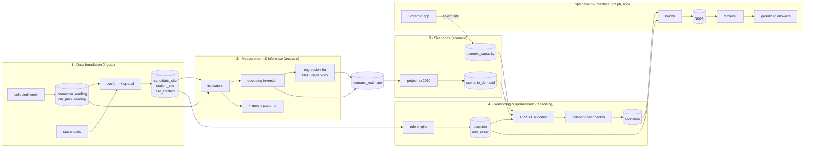

# OptEV+ System Design

> **This document is binding.** Every person and every AI assistant builds what it specifies,
> with the names it specifies. If your task needs something not defined here, or you think
> something here is wrong, **stop and raise it**: change this file by PR, approved by the
> owners it affects. Never improvise a table, function, threshold or file layout in code.

**Version** 1.10 · 20 Oct 2026 · **Owner** Ghanashyam (team lead)
**Built from** the submitted proposal (13 Sep), the Dataset Guide v2 (28 Sep), the proposal
presentation (29 Sep), the frozen contracts, and the knowledge graph spec (`specs/005`).

---

## 0. How to use this document

1. Read §1–3 once. They are short and apply to everyone.
2. Read **your stage** in §4. It names your package, modules, the functions you must expose,
   the tables you read and write, the method, and how your work is checked.
3. Build against `optev.sample` (§3.6) until real data is in PostgreSQL.
4. Before opening a PR, check §8 (definition of done).

| Package | Section | Owner(s) | Issues |
|---|---|---|---|
| `ingest/` | §4.1 | Shrey, Gurneet · Sushant (collection, Neon) · Ghanashyam (coverage) | #2, #6–#12 |
| `analysis/` | §4.2 | Sushant | #13–#16 |
| `scenario/` | §4.3 | Sushant, Shrey · Gurneet, Ghanashyam (planned capacity) | #28, #29 |
| `reasoning/` | §4.4 | Gurneet (rules) · Shrey (allocation, checker) | #17–#23 |
| `graph/` | §4.5 | Ghanashyam | #24–#27 |
| `app/` | §4.6 | Gurneet (shell) · each owner their view | #30–#34 |
| `pipeline.py` | §5 | All four | #35 |
| `evaluation/` | §6 | Shared, one baseline each | #36–#39 |

---

## 1. What the system does

A government planner asks **how many new public charging points to add, and where**. They give:

| Input | Values | Required |
|---|---|---|
| Area | One planning area (URA `PLN_AREA_C`), or island-wide | Yes (island-wide by default) |
| Points | The number of new charging points to place | The main input |
| Budget | SGD, turned into a cap on points with `COST_PER_POINT_SGD` | Optional |
| Scenario | `observed`, or growth scenario `low`, `base`, `high` | Yes (`observed` by default) |

At least one of points or budget must be given. **No dataset supplies a budget or a points
target**: both come from the planner. Points is the main input because that is how the
government plans: LTA's target is stated in points (60,000 by 2030, 40,000 of them in public
car parks), and HDB car park chargers are installed by operators who pay the government a
concession fee for the right, so public spending per point is not the usual lever. Sources are
in §3.5.

OptEV+ returns the proposal's three outputs:

1. a **ranked set of candidate sites**,
2. a **constrained allocation**: how many new points go to each site, within the requested
   number (and the budget, if given) and site capacity limits,
3. a **traceable reason** for every site accepted, rejected, deferred or made conditional.

**Scope.** Data is collected island-wide. Analysis is aggregated over the 55 planning areas.
Detailed evaluation and the demo use **one planning area**, chosen after the first full week
of data by a criterion stated in advance (proposed: the area with the highest share of
saturated charging-point snapshots, among areas with at least 30 matched points and 20
candidate sites without charging; to be confirmed by the team before results are seen).

**Out of scope** (from the proposal): commercial tendering, consumer-facing charger
recommendation, electrical engineering approval, any vehicle-owner records, and private
car parks (we plan the 40,000 public points only). Recommended sites are planning
candidates; electrical capacity and land access need separate verification.

---

## 2. Architecture

### 2.1 Five stages and the tables between them



### 2.2 Components and where they run

| Component | Technology | Role |
|---|---|---|
| Database | PostgreSQL + PostGIS on **Neon** | **Source of truth** for every number and record |
| Knowledge graph | **Neo4j Aura Free** | Evidence and reasoning links for explanations. Rebuilt from Postgres; never the source of a number |
| Collector | One week of 5-minute polls, 7–14 Oct 2026 (`Miscellaneous/collector/`) | Loaded once into Postgres at 30-minute snapshots. No scheduled collector |
| Optimiser | **OR-Tools CP-SAT** | Allocation under constraints |
| ML | **scikit-learn** | k-means patterns; regression for no-charger sites |
| Explanation | **LangGraph** + one LLM provider (open decision §9) | Grounded answers from retrieved evidence only |
| App | **Streamlit** + **pydeck**, on Streamlit Community Cloud | Map, rankings, allocation, evidence, selection controls |

### 2.3 Rules that hold everywhere

1. **Observed, simulated and planned data never merge.** Readings and indicators are
   observed. `scenario_demand` is simulated. `planned_capacity` is planned. No function
   writes a simulated or planned value into an observed table, and no number is ever
   computed by mixing layers without saying so.
2. **`utilisation` is `None`, never `0`, when there is no supply.** The database enforces it.
3. **A connector counts as installed only once seen available or occupied.**
4. **Packages talk through Postgres tables and the contracts only.** Never import another
   workstream's internals. A stage reads the tables the previous stage wrote.
5. **Every declared number comes from `optev.assumptions`.** Never hard-code one.
6. **Every stage is re-runnable.** Writes are upserts keyed on the table's primary key;
   running a stage twice gives the same tables.

---

## 3. Shared foundations

### 3.1 Contracts (frozen)

`optev/contracts/` defines every object that crosses a package boundary: `CarPark`,
`Station`, `Connector`, `CandidateSite`, `CarParkReading`, `ConnectorReading`,
`SiteIndicators`, `DemandEstimate`, `Rule`, `RuleResult`, `Decision`, `Allocation`,
`AllocationItem`, `InfeasibilityReport`, `Scenario`, `PlannedCapacity`, `PlanningArea`,
`Coordinate`, and the enums. Functions in §4 take and return these types. Changing a
contract needs all four owners.

### 3.2 Database tables

Migrations `001_init.sql` and `002_pipeline.sql` create every table below. Apply with
`uv run optev-db migrate`. Ingest-internal staging tables are allowed if prefixed `stg_`.

| Table | Mirrors | Written by | Read by |
|---|---|---|---|
| `planning_area` | PlanningArea | ingest | all |
| `car_park`, `station`, `connector` | CarPark, Station, Connector | ingest | analysis, reasoning, graph |
| `car_park_reading`, `connector_reading` | readings | ingest `load_collected` | analysis |
| `stg_collect_slot` | one row per feed per 30-minute slot loaded | ingest `load_collected` | ingest coverage |
| `candidate_site` | CandidateSite | ingest | all |
| `station_site` | station-site association | ingest | analysis, graph |
| `site_context` | features (land use, residents, amenities, nearest point) | ingest | analysis, reasoning |
| `coverage_report` | data-quality metrics | ingest | app, report |
| `site_indicators` | SiteIndicators | analysis | reasoning, graph, app |
| `demand_estimate` | DemandEstimate (+ `method`) | analysis | scenario, reasoning, graph, app |
| `site_pattern` | cluster per site | analysis | app, graph |
| `scenario` | Scenario | scenario | reasoning, graph, app |
| `scenario_demand` | DemandEstimate per scenario | scenario | reasoning |
| `planned_capacity` | PlannedCapacity | scenario (via app) | reasoning, graph, app |
| `rule` | Rule (+ `on_fail`) | reasoning | graph, app |
| `decision`, `rule_result` | Decision, RuleResult | reasoning | reasoning, graph, app |
| `allocation`, `allocation_item` | Allocation, AllocationItem | reasoning | graph, app, evaluation |
| `infeasibility` | InfeasibilityReport | reasoning | graph, app |

Baseline decisions, which belong to no scenario, use `scenario_id = 'observed'`.

### 3.3 Identifiers

Stable, deterministic ids, so every join and every graph MERGE lines up:

| Thing | Id |
|---|---|
| HDB car park site | `hdb:<car_park_no>` (e.g. `hdb:HE12`) |
| URA car park site | `ura:<PP_CODE>` |
| Mall car park site | `mall:<CarParkID>` |
| Hawker centre / community club / petrol station | `hawker:<id>` / `cc:<id>` / `petrol:<id>` from the source dataset |
| Station | LTA `locationId` |
| Connector | LTA `evCpId` |
| Planning area | URA `PLN_AREA_C` |
| Allocation | `<scenario>:<area or all>:points=<n or ->:budget=<SGD to 2 dp, or ->`, e.g. `base:TM:points=12:budget=-`, `base:all:points=-:budget=150000.00` |
| Infeasibility report | `<scenario>:<area or all>:requested=<n>`, e.g. `base:PR:requested=40` |
| Dataset | `ds-<short>` (e.g. `ds-lta-evcbatch`) |
| Policy document | `doc-<short>` (e.g. `doc-lta-eccg-2025`) |
| Declared assumption | `asm-<short>` (e.g. `asm-session-hours`) |
| Sample data | `SYN-…` (never appears in real tables) |

The allocator (#21, #23) writes the allocation and report ids in exactly this format to
`allocation.allocation_id` and `infeasibility.report_id`. The graph builds the same ids with
`allocation_key` and `infeasibility_key` in `optev/graph/schema.py`, so one allocation has one
id everywhere. Re-running the same request replaces its rows. A rule's `source_ref` is a
`ds-`, `doc-` or `asm-` id; its prefix says which kind of evidence it is.

### 3.4 Time bins

All times are Singapore time (UTC+8). A demand time bin is one of:

- `wd-00` … `wd-23`: an hour of the day on weekdays (Mon–Fri),
- `we-00` … `we-23`: an hour of the day on weekends,
- `all`: the daily average, `(5 × mean of wd bins + 2 × mean of we bins) / 7`.

The database rejects any other value.

### 3.5 Assumptions

`optev/assumptions.py` holds every declared value, with its unit and source:
`MEAN_SESSION_HOURS` (3.0 h), `RELIABLE_UP_TO` (0.93, to be measured), `IDLE_BELOW` (0.05),
`GROWTH_LOW/BASE/HIGH` (placeholders until #28), `HORIZON_MONTHS` (51),
`MAX_SHARE_OF_LOTS` (0.15), `COST_PER_POINT_SGD` (9,250; tested at `COST_LOW_SGD` 5,500 and
`COST_HIGH_SGD` 10,500), `MATCH_THRESHOLDS_M` (50, 100, 200),
`AMENITY_LINK_M` (150), `SNAPSHOT_MINUTES` (30). Placeholders must be replaced with cited
values before the report.

**Cited values and planning facts**

| Value or fact | Source | What the source says | How we use it |
|---|---|---|---|
| `MAX_SHARE_OF_LOTS` = 0.15 | [LTA factsheet, 4 Mar 2021](https://www.lta.gov.sg/content/ltagov/en/newsroom/2021/3/news-release/Accelerating_nationwide_deployment_of_electric_vehicle_charging_points.html) | New HDB car parks get electrical capacity for slow charging at 15% of their lots | Upper limit on points per site. Older car parks may have less, so electrical checks stay out of scope (§1) |
| `COST_PER_POINT_SGD` = 9,250 (5,500 to 10,500) | [LTA ECCG Guidelines and FAQs, 5 Mar 2025](https://www.lta.gov.sg/content/dam/ltagov/industry_innovations/Technologies/Electric_Vehicles/PDF/ECCG_Guidelines_and_FAQs_05032025.pdf) | Worked examples of installed cost per charger: equipment, licensed electrical worker fees, cabling. Example 3 averages $9,250; examples 1 and 2 total $5,500 and $10,500 | Used only when a budget is given. These are grant examples for condominium chargers, not a market survey; we count one charger as one point and report results at both ends |
| Points are the planning unit | LTA factsheet, 4 Mar 2021 (above) | 60,000 points by 2030: 40,000 in public car parks, 20,000 in private premises | Why points is the main input |
| Operators fund HDB chargers | [LTA, 2 Nov 2022](https://www.lta.gov.sg/content/ltagov/en/newsroom/2022/11/news-releases/more_EV_charging_points_to_be_deployed.html) | Five operators won the HDB tender; they pay a concession fee for the right to install and operate | Why budget is optional |
| Demand first, capacity permitting | [MOT written reply, 14 Oct 2025](https://www.mot.gov.sg/news-resources/newsroom/progress-on-installation-of-ev-chargers-in-hdb-car-parks-and-public-spaces/) | Scale up in "carparks with high charging demand, electrical capacity permitting" | Matches our objective (demand) and the room limit per site |

### 3.6 Sample data

`optev.sample` (see its README) is a synthetic slice with the same shapes as the real
tables, an answer key for demand (`truth()`), reference decisions and a reference allocation.
Every public function in §4 must have tests that run on it.

---

## 4. Stages

### 4.1 Stage 1 · Data foundation (`ingest/`)

**Purpose.** Turn 14 government datasets into one table of candidate sites and a clean,
timestamped history of readings, reporting coverage rather than assuming it.

**Datasets** (Dataset Guide v2): A live feeds (LTA EV Charging Points Batch, LTA Carpark
Availability, HDB Carpark Availability) · B registry (HDB Carpark Information, URA Parking
Capacity) · C boundaries (MP2025 Planning Areas, MP2025 Land Use) · D amenities (NEA hawker
centres, PA community clubs, Customs petroleum premises) · E residents by planning area
(SingStat) · F growth (car registrations, LTA EV dashboard; read by stage 3) · G optional
quarterly charger CSV; cost per point from the LTA ECCG guidelines (§3.5).

**Modules and interface**

```python
# optev/ingest/collect.py   (run once: optev-db load-collected <path> [--day YYYY-MM-DD])
def load_collected(root: Path, day: date | None = None) -> dict[str, int]
                                                # rows written per reading table

# optev/ingest/static.py
def load_static() -> dict[str, int]             # rows loaded per static source

# optev/ingest/conform.py
def conform() -> dict[str, int]                 # rows upserted per table

# optev/ingest/coverage.py
def coverage_report(window_start: datetime, window_end: datetime) -> dict[str, float]
```

**Method**

1. **Collect.** The observed readings are one week of 5-minute polls, 7 Oct 2026 13:55 to
   14 Oct 2026 10:56 SGT, collected by `Miscellaneous/collector/poll_ev_data.py` (HDB
   data.gov.sg car park availability and LTA `EVCBatch`). There is no live collector.
   `load_collected` reads the raw files only and keeps the poll nearest each :00 and :30 SGT
   slot, within 150 s; a slot with no poll is missing, never filled. `collected_ts` is the
   poll's fetch time. EV status mapping: `"0"` → occupied, `"1"` → available, `""` →
   unavailable; every connector is kept, including unavailable ones. Car parks: id
   `hdb:<car_park_no>`, keep `lot_type = "C"`, `provider_ts` is that car park's own
   `update_datetime`. One bad record is logged and skipped; it never fails the run. Each slot
   loaded is recorded in `stg_collect_slot`, and a slot already there is skipped, so a re-run
   writes nothing.
   **Scope decision:** URA and mall car parks are out of scope for readings because their feed
   (LTA Carpark Availability) was not collected; car park readings cover HDB car parks only.
2. **Static loads.** URA places with `NO_CAR > 0` only. Petrol stations filtered to service
   stations by name; if too noisy, drop them and record why.
3. **Conform.** Convert SVY21 to WGS84 with pyproj (EPSG:3414 → 4326); compute every distance
   in EPSG:3414 metres. Set `connector.ever_active` once a connector is seen available or
   occupied. Build `candidate_site` from car parks plus amenities with **no** car park within
   `AMENITY_LINK_M`; an amenity near a car park becomes `site_context.amenities_nearby` for
   that car park, never a second site. Build `station_site` at the thresholds in
   `MATCH_THRESHOLDS_M`, keeping one row per station-site pair with the smallest threshold
   met. A station's connectors count toward `candidate_site.existing_connectors` at its
   nearest site only (ties by `site_id`), so no connector is counted twice. Match registry
   car parks to the readings by id and set `car_park.has_live_feed`; an HDB car park's
   `total_lots` comes from its latest reading, since the registry has none. Count every
   reading that cannot be traced to a coordinate, and every registry row without readings.
   Fill `site_context` by point-in-polygon on MP2025 land use and planning areas.
4. **Coverage (#12).** Write to `coverage_report`: snapshot completeness per feed, median
   freshness (`collected_ts − provider_ts`), share of stations matched at each threshold,
   share of sites with a planning area, amenities linked to a car park.

**Checked by.** Tests on sample shapes; coverage numbers reported (targets in §6).

### 4.2 Stage 2 · Measurement & inference (`analysis/`) · knowledge discovery

**Purpose.** Measure how busy each site is, infer demand including drivers turned away,
discover usage patterns, and estimate demand where no charger exists.

**Modules and interface**

```python
# optev/analysis/indicators.py
def site_indicators(window_start: datetime, window_end: datetime) -> list[SiteIndicators]
def occupancy_by_bin(window_start: datetime, window_end: datetime) -> dict[str, dict[str, float]]
    # site_id -> time_bin -> mean occupancy

# optev/analysis/demand.py
def erlang_b(c: int, a: float) -> float
def invert_occupancy(c: int, occupancy: float) -> float          # arrivals per hour
def infer_demand(indicators: list[SiteIndicators],
                 occupancy: dict[str, dict[str, float]]) -> list[DemandEstimate]

# optev/analysis/patterns.py
def find_patterns(occupancy: dict[str, dict[str, float]]) -> dict[str, int]   # site -> cluster

# optev/analysis/unserved.py
def estimate_unserved(sites: list[CandidateSite], observed: list[DemandEstimate],
                      context: dict[str, dict[str, float]]) -> list[DemandEstimate]
```

**Method**

1. **Indicators (#13).** Per snapshot, occupancy = occupied ÷ (occupied + available) over the
   site's matched connectors; unavailable connectors are excluded. `utilisation` = mean over
   snapshots; `saturated_fraction` = share of snapshots with none available and at least one
   occupied; `observation_coverage` = snapshots seen ÷ expected. `supply_state`: `no_supply`
   with no active connectors, `supply_idle` below `IDLE_BELOW`, else `supply_active`;
   `unobserved` when coverage is too low to say.
2. **Demand (#14).** Erlang loss model (Erlang B). For each site and **each time bin**:
   offered load `a` is the value giving the observed occupancy on `c` active connectors
   (bisection; occupancy rises monotonically in `a`); arrivals per hour =
   `a ÷ MEAN_SESSION_HOURS`. If occupancy ≥ `RELIABLE_UP_TO`, report the arrivals that give
   exactly `RELIABLE_UP_TO`, with `kind = lower_bound`. Write per-bin rows plus `all`;
   `all` is a lower bound if any bin is. `method = queueing`. **Estimate per bin, never once
   per whole window**: the sample shows a whole-window inversion underestimates busy sites by
   30–40% because demand peaks in the evening.
3. **Patterns (#15).** k-means (scikit-learn) on each site's 48-value occupancy profile
   (`wd-00…wd-23`, `we-00…we-23`), min-max normalised per site; k from 3 to 6, chosen by
   silhouette score; fixed `random_state`. Write `site_pattern` with a human label per cluster
   (e.g. "evening residential").
4. **Sites with no chargers (#16).** Supervised regression. Training rows: sites with
   `supply_active` and an `all` estimate of `kind = point` (lower-bound labels are excluded in
   version 1; a censored regression is the stated improvement). Features: mean car park
   occupancy at night (wd-00…wd-05) and by day (wd-09…wd-17), total lots, site kind, land use,
   amenities nearby, residents in area, distance to the nearest charging point. Models: linear
   regression as the baseline, then scikit-learn `HistGradientBoostingRegressor`; keep the
   better under leave-area-out validation. Predict `all` for `no_supply` sites, then spread it
   across bins with the mean normalised profile of training sites of the same kind.
   `method = regression`.

**Checked by.** Silhouette (patterns); MAPE against simulated known demand, which also
measures `RELIABLE_UP_TO` (queueing); MAE and Spearman ρ on hidden sites and hidden areas
against the planning-area average (regression). See §6.

### 4.3 Stage 3 · Scenarios & planned capacity (`scenario/`)

**Purpose.** Project demand to 2030 under declared growth, as a separate simulated layer,
and record planner selections without touching observed data.

```python
# optev/scenario/project.py
def make_scenarios() -> list[Scenario]                                   # low, base, high
def project(estimates: list[DemandEstimate], scenario: Scenario) -> list[DemandEstimate]

# optev/scenario/planned.py
def select_site(scenario_id: str, site_id: str, connectors: int,
                selected_by: str) -> PlannedCapacity
def clear_selection(scenario_id: str, site_id: str) -> None
def effective_connectors(scenario_id: str, sites: list[CandidateSite]) -> dict[str, int]
```

**Method.** Scenarios use `GROWTH` and `HORIZON_MONTHS`; #28 replaces the placeholder
multipliers with a growth rate fitted to monthly EV registrations and checked against the
LTA dashboard. Projected demand = observed estimate × multiplier, per site and bin, written
to `scenario_demand` with its `scenario_id`, **never** to `demand_estimate`. Lower bounds stay
lower bounds. Planner selections go to `planned_capacity`. When solving a scenario,
`effective_connectors` = existing + planned for that scenario only.

**Checked by.** Top-10 stability under ±20% growth, ±10% demand, and (when a budget is given)
cost at `COST_LOW_SGD` and `COST_HIGH_SGD`; back-cast error of
the growth fit on recent months.

### 4.4 Stage 4 · Reasoning & optimisation (`reasoning/`) · decision automation + optimisation

**Rules (#17–#19, Gurneet)**

```python
# optev/reasoning/rules.py
REGISTER = Path(__file__).parent / "register.toml"
def load_register(path: Path = REGISTER) -> tuple[list[Rule], dict[str, Outcome]]
def site_facts(site: CandidateSite, car_park: CarPark | None,
               indicators: SiteIndicators, context: dict[str, object]) -> dict[str, object]
def evaluate(site_id: str, facts: dict[str, object], rules: list[Rule],
             on_fail: dict[str, Outcome], scenario_id: str | None = None) -> Decision
def screen(sites: list[CandidateSite], car_parks: list[CarPark],
           indicators: list[SiteIndicators], context: dict[str, dict[str, object]],
           rules: list[Rule], on_fail: dict[str, Outcome],
           scenario_id: str | None = None) -> tuple[list[Decision], dict[Outcome, int]]
def write_decisions(cur: Cursor, rules: list[Rule], on_fail: dict[str, Outcome],
                    decisions: list[Decision]) -> dict[str, int]
def screen_all(database_url: str, scenario_id: str | None = None,
               write: bool = True) -> dict[Outcome, int]   # Postgres in, funnel out
# python -m optev.reasoning screen [--scenario ID] [--dry-run]
```

- **Register.** `reasoning/register.toml`, one entry per rule with every `Rule` field plus
  `on_fail` (`reject` or `conditional`). Each rule cites its source class and `source_ref`:
  a document, dataset or assumption id. Rules come from the policy documents and datasets in
  the proposal's references; any rule based on our own judgement is `project_assumption`.
  A rule is in the register because its source supports it, never because its facts happen
  to be loaded: a rule whose fact is missing simply defers.
- **Facts.** Keys available to rules: `kind`, `planning_area`, `total_lots`,
  `existing_connectors`, `car_park_type`, `supply_state`, `utilisation`, `land_use`,
  `amenities_nearby`, `nearest_point_m`. A missing value is absent from the dict, never 0.
- **Evaluation.** Evaluate **every** rule, never stop at the first failure. A rule whose
  required fact is missing gives `passed = None`.
- **Outcome policy**, in this order: any failing rule with `on_fail = reject` → **reject**;
  else any unevaluated rule → **defer**; else any failing `conditional` rule →
  **conditional**; else **accept**. A missing fact alone never rejects.
- **Checks.** Each rule's test is a function in `rules.CHECKS`, keyed by `rule_id`; a register
  rule with no check is an error, never a silent defer. A check may itself return
  `passed = None` when a fact the rule reads only for some kinds of site is missing (e.g.
  `car_park_type` for a car park); that is unevaluated, like a missing required fact. Before
  the checks run, derived facts
  are added by forward chaining while their inputs are present: `room` =
  `floor(MAX_SHARE_OF_LOTS × total_lots) − existing_connectors`, floored at 0. A result's
  `detail` names the missing facts when unevaluated, and the computed value (e.g. `room 89`)
  when there is one.
- **Screening (#19).** `screen` evaluates every candidate site (each with its latest
  indicators window) and returns the decisions with the count per outcome, all four always
  present, so the funnel is visible. `write_decisions` upserts `rule` from the register, then
  `decision` and `rule_result` per (site, scenario), replacing earlier results;
  `scenario_id` None is stored as `'observed'`. The allocator reads the screened set.
  `screen_all` reads `candidate_site`, `car_park`, `site_indicators` and `site_context`,
  screens, writes (unless `write` is False) and returns the funnel.

**Allocation (#20–#21, Shrey)**

```python
# optev/reasoning/allocate.py
def allocate(decisions: list[Decision], sites: list[CandidateSite],
             demand: list[DemandEstimate], scenario: Scenario, *,
             planning_area: str | None = None, requested_connectors: int | None = None,
             budget: float | None = None) -> Allocation | InfeasibilityReport
```

- **Request:** `requested_connectors` (the planner's points), `budget`, or both; neither raises
  `ValueError`. `planning_area` None means island-wide. The request is copied onto the
  `Allocation` or `InfeasibilityReport`.
- **Eligible sites:** outcome accept or conditional, inside `planning_area` if given. Room per site =
  `floor(MAX_SHARE_OF_LOTS × total_lots) − effective_connectors`, floored at 0.
- **Objective:** maximise average drivers per hour rescued,
  `Σ_site Σ_bin w_bin × λ_bin × (B(c, a_bin) − B(c + x, a_bin))`, with `w = 5/7 ÷ 24` for
  weekday bins and `2/7 ÷ 24` for weekend bins, `λ` from `scenario_demand` (or
  `demand_estimate` for `observed`), `c` = effective connectors.
- **CP-SAT formulation:** binary `y[site, k]` for the k-th new point, `x = Σ_k y`, ordered
  `y[k] ≥ y[k+1]`; objective coefficients are the marginal gains, scaled ×1000 to integers.
  Constraints: `Σ x = requested_connectors` if given; `Σ COST_PER_POINT_SGD × x ≤ budget` if
  given (with only a budget, place as many points as it pays for); `x ≤ room`. No minimum per
  planning area: an area gets points only where they rescue the most drivers, so 0 is a valid
  answer. Each item's `cost` is
  `COST_PER_POINT_SGD × connectors`, shown as an estimate even without a budget. Time limit
  30 s; record solver status and optimality gap.

**Checker (#22, Shrey).** `optev/reasoning/checker.py`, `check(allocation, decisions, sites)
-> Allocation`; the request (area, points, budget) is read from the allocation. It **must not
import `allocate.py`**. It re-tests every constraint above
independently, fills `violations`, and sets `checked = True`. Only checked allocations are
written or shown.

**Unmet requirement (#23).** When infeasible: `max_feasible` = the most connectors any feasible
plan allows; `binding_constraints` = each constraint group (requested, budget, room)
whose removal alone makes the request feasible; `affected_areas` stays empty (kept on the
contract; no per-area constraint exists). With only a budget, `requested_connectors` = `floor(budget / COST_PER_POINT_SGD)`.

**Checked by.** Rules: 100% agreement with 30 test sites labelled in advance by two people who
did not write the rules (agreement measured with Cohen's κ), and 100% reason codes. Allocation:
0 violations, the checker catches every planted fault, and the plan beats every baseline in §6.

### 4.5 Stage 5 · Explanation (`graph/`) · cognitive techniques

```python
# optev/graph/schema.py, ddl.py   (#24, PR #47)
# optev/graph/load.py
def load(data: Sample, session: Session) -> dict[str, int]    # MERGE a bundle of contracts
def load_all(database_url: str) -> dict[str, int]             # read Postgres, then load()
def clear_sample(session: Session) -> int                     # remove what --sample loaded
# optev/graph/retrieve.py
def retrieve(question_type: str, **params: str) -> list[dict[str, object]]
# optev/graph/explain.py
def explain(question: str) -> Answer          # Answer: text, evidence, refused (bool)
```

- **Schema** as in `specs/005-knowledge-graph`: 16 node types keyed on contract ids; every rule
  linked to its source class and evidence.
- **Loader (#25).** `load_all` reads Postgres after each pipeline run into the same bundle
  as `optev.sample.Sample` and calls `load`, which MERGEs in batches of 500 using the key
  helpers in `schema.py`. Order: areas, datasets, documents, assumptions (first, so everything
  that cites them can link), car parks, stations, connectors, sites, `station_site`,
  indicators, `all` demand estimates, rules, scenarios, decisions with `EVALUATED`,
  allocations, infeasibility. Links: every indicator `DERIVED_FROM` `ds-lta-evcbatch`; every
  estimate `ASSUMES` `asm-session-hours`, lower bounds also `asm-reliable-up-to`; a rule links
  to whatever its `source_ref` names. A missing value is written as an absent property.
  Never loads raw readings or per-bin estimates. Until Postgres is live,
  `python -m optev.graph load --sample` loads the sample, labelled `:Sample`, and
  `clear --sample` removes it before real data goes in.
- **Retrieval (#26).** Fixed, parameterised Cypher per question type, in
  `retrieve.TEMPLATES`: `why_site`, `why_not_site`, `demand_basis`, `compare_sites`,
  `rule_sources`, `infeasible_request`, `area_saturation` (planning areas ranked by how often
  every charger was in use) and `assumptions_used` (every declared value behind a site's
  estimate and decision). Never generated Cypher; values reach it only as parameters, and a
  test rejects any template that writes or uses a name outside `schema.py`. Every row names
  the nodes it came from, so answers can cite them. An empty result is returned as
  "no evidence", never filled in. `python -m optev.graph ask <type> name=value` runs one.
- **Explanation (#27).** LangGraph flow: classify the question → refuse if out of scope →
  retrieve → the LLM answers **only** from the retrieved evidence → every number in the answer
  must appear in the evidence → retry once, otherwise refuse.

**Checked by.** ≥ 90% of 20 questions answered correctly (answers written in advance from the
source tables), 100% citing evidence, 0 unsupported claims, Precision@k on retrieval.

### 4.6 App (`app/`)

Streamlit multipage app. `app/data.py` is the only module that reads data: from Postgres when
`DATABASE_URL` is set, otherwise from `optev.sample`, so every page works before the database
is ready.

| Page | Owner | Shows |
|---|---|---|
| Map (shell, #30) | Gurneet | Sites coloured by outcome, sized by allocated points; demand as H3 hexagons; controls |
| Rules (#31) | Gurneet | Each site's decision and every rule result with its source class |
| Allocation (#32) | Shrey | The plan, estimated cost (against the budget if given), checker result, unmet requirement |
| Demand (#33) | Sushant | Indicators, patterns, estimates; lower bounds marked as such |
| Evidence (#34) | Ghanashyam | Ask why; answer with its evidence trail |

Sidebar controls: planning area (or island-wide), number of points, optional budget, scenario.
Selecting a site calls `scenario.planned.select_site` and re-runs allocation. **No business logic in the app.**

---

## 5. Pipeline (#35)

`optev/pipeline.py`, run as `uv run python -m optev.pipeline run --scenario base --area TM --points 12`.
`--area` is a planning-area code (omit it for island-wide); `--points`, `--budget` or both must be
given.
Order: migrate check → `conform` → `site_indicators` + `occupancy_by_bin` → `infer_demand` →
`find_patterns` → `estimate_unserved` → `make_scenarios` + `project` → rules for every site →
`allocate` → `check` → graph `load_all`. Each step reads only what earlier steps wrote and can
be re-run on its own. Target: one planning area end to end in under 10 minutes.

---

## 6. Evaluation (`evaluation/`, #36–#39)

| Stage | Metric | Answer key | Baseline | Target |
|---|---|---|---|---|
| 1 | Completeness, freshness, join coverage | The 330 half-hour slots of the collected week | — | ≥ 95% complete; 100% of sites in an area |
| 2 patterns | Silhouette | — | — | ≥ 0.5 |
| 2 queueing | MAPE by occupancy band | Simulation with known demand (`truth()`) | Occupancy alone | ≤ 10% below `RELIABLE_UP_TO` |
| 2 regression | MAE, Spearman ρ | Hidden sites, hidden areas | Planning-area average | Beat baseline; ρ ≥ 0.5 |
| 3 | Top-10 stability; back-cast MAPE | Recent months hidden | — | ≥ 7 of 10 stay |
| 4 rules | Agreement, reason codes | 30 test sites, two raters, κ ≥ 0.7 | — | 100%; 100% |
| 4 allocation | Violations; uplift in drivers rescued | Same request (area, points) and rules | See below | 0; beat all |
| 5 | Accuracy, citation rate, unsupported claims, Precision@k | 20 questions answered from source tables | — | ≥ 90%; 100%; 0 |

**Baselines**, each producing an `Allocation` for the same request (area, points) and rules, scored by the
same objective: busiest first (#36), spatial spread (#37), extend sites that already have
chargers (#38), population share and random averaged over 100 seeds (in the harness, #39).
**End-to-end number:** unmet demand covered per new point against the best baseline.

---

## 7. Engineering rules

- **Branches:** `<name>/<issue>-<short>`. One issue per branch. Never commit to `main`.
- **Specs:** plan in `specs/NNN-<name>/spec.md` before coding, quoting the §4 section you are
  implementing. Append a `## Checkpoint` before stopping.
- **Tests:** every public function has tests that run on `optev.sample`. Lint (ruff), types
  (mypy) and tests (pytest) pass before a PR.
- **Code:** type hints everywhere; contracts at every boundary; modules under ~300 lines; SQL
  through psycopg with parameters, never string formatting; logging with `logging`, `print`
  only in CLIs; secrets only from the environment.
- **Never:** change contracts without all four owners; commit `.env`, credentials or data
  (except `optev/sample`); merge your own PR.

## 8. Definition of done (every PR)

- [ ] Implements a §4 section with the exact module paths, function names, tables and bins.
- [ ] Uses `optev.assumptions` for every declared value.
- [ ] Respects the three invariants (§2.3).
- [ ] Tests run on `optev.sample`; ruff, mypy and pytest pass.
- [ ] Spec updated with a checkpoint; reviewed by a CODEOWNER other than the author.

## 9. Open decisions

| # | Decision | Owner | By |
|---|---|---|---|
| 1 | LLM provider and key for #27 | Ghanashyam | 12 Oct |
| 2 | Confirm the demo-area criterion (§1) | Team | Before results |
| 3 | Minimum points per chosen site? The HDB tender asked for 3 to 6 per car park ([LTA, 29 Mar 2022](https://www.lta.gov.sg/content/ltagov/en/newsroom/2022/3/news-releases/ramping_up_charging_infrastructure.html)) | Shrey, Gurneet | 14 Oct |
| 4 | Growth multipliers fitted from registrations | Sushant (#28) | 14 Oct |
| 5 | Contract additions (estimate method, scenario on estimates, pattern label) | All four | Only if tables prove insufficient |

## 10. Change log

- **1.0 · 10 Oct 2026.** First binding version.
- **1.1 · 11 Oct 2026.** Planner inputs are area and points, with budget optional (§1, §4.4,
  §4.6, §5); no dataset supplies a budget. Cited `MAX_SHARE_OF_LOTS` (0.15) and
  `COST_PER_POINT_SGD` (9,250, range 5,500 to 10,500) in §3.5. Contracts: `Allocation.budget`
  is optional and `planning_area` is added to `Allocation` and `InfeasibilityReport`, which
  needs all four owners' approval. Checker no longer takes `budget`.
- **1.2 · 14 Oct 2026.** Allocation and infeasibility report ids defined in §3.3, so the
  allocator and the graph use one id per allocation. Budgets are written to the cent.
- **1.3 · 15 Oct 2026.** Observed readings are the week collected 7–14 Oct 2026, loaded once
  at 30-minute snapshots; no scheduled collector (§2.2, §4.1). `collect_ev` and
  `collect_car_parks` replaced by `load_collected`. New ingest table `stg_collect_slot`
  (§3.2). HDB car parks only. Stage 1 completeness measured against the week's 330 slots
  (§6). Agreed by Ghanashyam (spec 002).
- **1.4 · 18 Oct 2026.** Loader split into `load` (a bundle of contracts) and `load_all`
  (Postgres), so the graph is built and tested on the sample before Postgres is live.
  Reference ids (`ds-`, `doc-`, `asm-`) added to §3.3; load order puts references first.
- **1.5 · 18 Oct 2026.** Retrieval adds `area_saturation` and `assumptions_used`, the two
  planner questions in #26 the first six did not cover (§4.5).
- **1.6 · 19 Oct 2026.** Conform (§4.1 step 3) states what was left open: a station's
  connectors count at its nearest site only; registry car parks are matched to the readings,
  with HDB lot counts from the feed; unmatched rows are counted both ways (spec 003, #53).
- **1.7 · 19 Oct 2026.** Rules (§4.4) name the screening functions `screen` and
  `write_decisions`, and state how checks and derived facts work (spec 008, #18, #19).
- **1.8 · 20 Oct 2026.** No minimum points per planning area: `MIN_POINTS_PER_AREA` removed
  (§3.5, §4.4). It was our own uncited number, and island-wide it made any request under
  about 100 points impossible. Points go only where they rescue the most drivers.
- **1.10 · 20 Oct 2026.** Rules (§4.4): a rule is registered for its source, not for data
  availability; a check may return `passed = None` for a fact it needs only for some sites;
  `screen_all` and `python -m optev.reasoning screen` screen Postgres (spec 008). Numbered
  1.10 because #58 claims 1.9.
