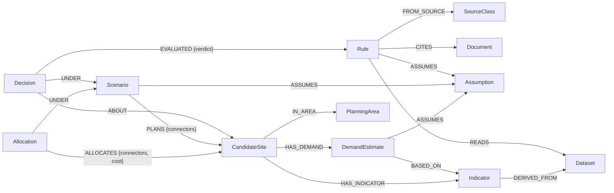

# 005 · Knowledge graph schema

**Owner:** P4 (Ghanashyam)  ·  **Status:** schema ready for review  ·  **Branch:** `p4/graph-schema`

## Problem

Stage 5 has to answer "why this site?" with evidence, not with text an LLM composed. That
needs the reasoning stored as relationships: decision → rules → data → source, and
decision → scenario → assumptions. Until the shape is fixed, the loader (#25), the
retrieval templates (#26) and every workstream producing decisions have nothing to load
into.

## Contracts touched

Reads only. No contract changes. Every node mirrors a model in `optev/contracts/` and is
keyed on its identifier; `schema.py` is the single source and the tests fail if the two
drift apart.

## Approach

**Postgres holds the numbers, the graph holds the relationships.** Raw readings never
enter the graph: thousands of snapshots per site would add nothing a traversal needs.
Indicators summarise them and point back to the dataset they came from.

### Nodes

| Label | Key | Mirrors | Produced by |
|---|---|---|---|
| PlanningArea | `code` | PlanningArea | ingest (1.6) |
| CarPark | `car_park_id` | CarPark | ingest (1.2) |
| Station | `station_id` | Station | ingest (1.3) |
| Connector | `connector_id` | Connector | ingest (1.3) |
| CandidateSite | `site_id` | CandidateSite | ingest (1.4–1.5) |
| Indicator | `indicator_id`* | SiteIndicators | analysis (2.1) |
| DemandEstimate | `estimate_id`* | DemandEstimate | analysis (2.2, 2.4) |
| Dataset | `dataset_id` | graph only | ingest: one per government source |
| Document | `doc_id` | graph only | rules (3.1): policy documents cited |
| SourceClass | `code` | `RuleSource` enum | seeded by `apply-schema` |
| Rule | `rule_id` | Rule | rules (3.1) |
| Assumption | `assumption_id` | graph only | scenario (6.1), rules, analysis |
| Scenario | `scenario_id` | Scenario | scenario (6.1) |
| Decision | `decision_id`* | Decision | rules (3.2–3.3) |
| Allocation | `allocation_id`* | Allocation | optimisation (4.2–4.3) |
| Infeasibility | `report_id`* | InfeasibilityReport | optimisation (4.4) |

\* Built by the helpers in `schema.py` (`decision_key`, `indicator_key`, …) because the
contract has no single identifier. Always use the helper; a hand-built key creates a
duplicate node on the next run.

### Relationships



Also: `Connector-[:PART_OF]->Station`, `Station-[:NEAR {distance_m, threshold_m}]->CandidateSite`,
`CandidateSite-[:AT]->CarPark`, `CarPark|Station-[:IN_AREA]->PlanningArea`,
`Infeasibility-[:FOR]->Scenario`, `Infeasibility-[:AFFECTS]->PlanningArea`.
The full list, with what each one means, is `RELATIONSHIPS` in `schema.py`.

### Rule provenance: the part that matters

Every Rule links to exactly one SourceClass, and through it to its evidence:

| SourceClass | Rule also links to | A planner reads it as |
|---|---|---|
| `gov_policy` | `CITES` → Document | "Government policy says so" |
| `gov_dataset` | `READS` → Dataset | "A published field says so" |
| `math_constraint` | nothing | "Arithmetic or a physical limit" |
| `project_assumption` | `ASSUMES` → Assumption | "Our assumption; weigh it yourself" |

So an explanation can say whether a site failed government policy or one of our own
assumptions, a distinction no similarity search can make. The rule register (3.1) should
put the target's key in `Rule.source_ref`: a `doc_id`, `dataset_id` or `assumption_id`.

### The contract invariants, in graph form

1. **Layers never merge.** Planned capacity is `Scenario-[:PLANS]->CandidateSite`. Nothing
   planned is ever written onto a Site, Station or Connector.
2. **Undefined is absent, never 0.** Neo4j cannot store null, so a missing utilisation is
   simply a missing property.
3. **Unevaluated is not failed.** `EVALUATED.verdict` is `passed`, `failed` or
   `unevaluated`. A missing required fact must never read as a failed rule.

### What #26 will ask of it

```cypher
// Why was this site decided the way it was, and on whose authority?
MATCH (d:Decision {decision_id: $decision_id})-[:ABOUT]->(s:CandidateSite)
OPTIONAL MATCH (d)-[e:EVALUATED]->(r:Rule)-[:FROM_SOURCE]->(c:SourceClass)
OPTIONAL MATCH (r)-[:CITES|READS|ASSUMES]->(evidence)
RETURN s.site_id, d.outcome,
       collect({rule: r.rule_id, verdict: e.verdict, source: c.code,
                evidence: coalesce(evidence.title, evidence.name)}) AS reasons
```

If a traversal returns nothing, the answer says so. It never fills the gap.

## Verification

```bash
cd SystemCode
uv run pytest tests/test_graph_schema.py      # 9 tests, no database needed
uv run python -m optev.graph schema           # prints the 19 Cypher statements
# once Aura exists (#3) and .env is filled in:
uv run python -m optev.graph ping             # -> ok
uv run python -m optev.graph apply-schema     # -> applied 19 statements ...
uv run pytest tests/test_graph_live.py        # applies twice, checks constraints and seeds
```

## Open questions

1. **Scenario-specific demand.** Settled by the design: projections live in their own
   `scenario_demand` table (§3.2) and the graph loads only observed `all` estimates (§4.5),
   so the two never share a key.
2. **Estimate method.** Partly settled: `demand_estimate.method` exists in Postgres (§3.2) but
   not on the contract. Until it does (design §9, decision 5), the absence of `BASED_ON` marks
   a regression estimate.
3. **Which NEAR to keep.** Settled by `station_site` (§3.2): one row per station–site pair with
   the measured distance and the smallest threshold met, so one `NEAR` per pair.
4. **Aura.** Done (#3): provisioned, secrets set, schema applied, live tests pass. The
   heartbeat now writes daily, since the weekly one let the instance pause on 11 Oct.

## Checkpoint · 14 Oct 2026
- **Works:** `schema.py` (16 labels, 24 relationships, key helpers), `ddl.py` (16 constraints,
  3 indexes, source-class seed), CLI `ping|schema|apply-schema|heartbeat`, certifi fallback for
  macOS Python. Schema applied on Aura; unit and live tests pass.
- **Decided:** keys follow design 1.1–1.2: allocations keyed on the whole request
  (scenario, area, points, budget to the cent), reports on (scenario, area, requested); the
  allocator writes the same ids to Postgres (§3.3). `on_fail` on Rule. Heartbeat daily.
- **Half-built:** nothing in this PR. The loader is #25 (PR #50, stacked on this one).
- **Next:** merge this, then #50; then #26 retrieval templates against the loaded sample.
